<!-- datasheet:banner -->
<p align="center">
  <picture>
    <source media="(prefers-color-scheme: dark)" srcset=".github/assets/banner-dark.svg">
    
  </picture>
</p>
<!-- /datasheet:banner -->

# Study Copilot & Educational Practice Sandbox

A lightweight, native macOS Menu Bar application that acts as an academic study copilot. It allows you to select any region of your screen or read clipboard text to generate structured, step-by-step conceptual explanations for complex algorithms, code snippets, and practice problems.

Included is a completely isolated **Offline Practice Quiz Sandbox** (`http://127.0.0.1:8000`) for safely evaluating and testing screen-capture and vision-based analysis workflows.

---

<!-- datasheet:figure -->
## At a glance

<p align="center">
  <picture>
    <source media="(prefers-color-scheme: dark)" srcset=".github/assets/diagram-dark.svg">
    
  </picture>
</p>

| Characteristic | Detail |
| --- | --- |
| **App** | Native macOS menu bar app (`app.py`, built with `rumps` on PyObjC); work runs on background threads so the UI stays responsive |
| **Engines** | Offline mock (no key, no network), Claude 3.5 Sonnet (`ANTHROPIC_API_KEY`), Gemini 2.5 Flash (`GEMINI_API_KEY`) |
| **Input** | Interactive screen region, full screen, or clipboard text |
| **Sandbox** | Isolated offline practice quiz at `http://127.0.0.1:8000` for testing capture and vision safely |
<!-- /datasheet:figure -->

## Architecture Overview

```
┌────────────────────────────────────────────────────────┐
│ macOS Menu Bar: [🎓 Study Copilot]                     │
├────────────────────────────────────────────────────────┤
│  • 📐 Select Screen Region & Explain (Interactive)     │
│  • 📸 Capture Full Screen & Explain                    │
│  • 📋 Explain Clipboard Text                           │
│  • 📖 View Latest Explanation                          │
│  • ⚙️ Engine: [Mock | Claude 3.5 Sonnet | Gemini]      │
│  • 🌐 Open Practice Sandbox (localhost:8000)           │
└────────────────────────────────────────────────────────┘
```

1. **Native Menu Bar App (`app.py`)**: Built with `rumps` (PyObjC). Runs non-blocking background threads so the macOS UI remains responsive.
2. **Explainer Engine (`explainer_engine.py`)**:
   - **Offline Mock Mode:** Pre-configured simulation engine requiring zero API keys or network requests.
   - **Claude 3.5 Sonnet:** High-accuracy vision and conceptual analysis via the official Anthropic SDK (`ANTHROPIC_API_KEY`).
   - **Gemini 2.5 Flash:** High-speed multimodal understanding via the official `google-genai` SDK (`GEMINI_API_KEY`).
3. **Practice Sandbox (`mock_practice_server.py`)**: A local web server hosting sample algorithms and machine learning problems to test the tool against a mock exam interface.

---

## Quickstart

### 1. Launch Everything with One Command
```bash
./run.sh
```
This script will:
1. Start the local practice quiz in your default browser at `http://127.0.0.1:8000`.
2. Launch the **Study Copilot** icon in your macOS status bar (`🎓 Study Copilot`).

---

### 2. macOS Permissions (First Time Setup)
Because the app interacts with screen capture tools, macOS requires explicit permission:
* Go to **System Settings > Privacy & Security > Screen Recording**.
* Ensure your Terminal or IDE (e.g. Cursor / VS Code / Terminal) is enabled.

---

### 3. Setting Up Live AI Engines (Optional)
By default, the app runs in **Offline Mock Mode**. To connect live LLM backends:

```bash
# For Anthropic Claude
export ANTHROPIC_API_KEY="sk-ant-..."

# For Google Gemini
export GEMINI_API_KEY="AIzaSy..."

# Then run:
./run.sh
```
You can switch between engines on the fly using the **⚙️ Engine** dropdown in the menu bar.

## License

MIT. See [LICENSE](LICENSE).
